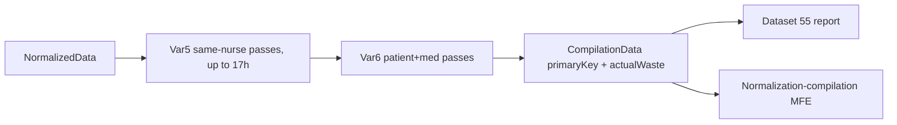

# Full Medication Waste (Dataset 55): data integrity fix

## Findings (verified in production SQL Lab, org 3)

- Production Dataset 55 SQL is identical to [Full_Medication_Waste_Dataset.yaml](repositories/shield-api/Superset/Dashboards/inventory-optimization-reports/full-medication-waste-report/datasets/DiversionDb/Full_Medication_Waste_Dataset.yaml). The joins are not double counting: `dispense_totals` sums the removes in a group, `remove_row` keeps one row per group, and "Wasted Amount" is `cd."actualWaste"` as stored.
- The wrong values come from `CompilationData.primaryKey` grouping in [compilation.py](repositories/python-diversion/src/services/compilation.py).

Taylor Monce, Lorazepam, group `5797639300`:
- `SMM294` removed 2 mg at 03:38. `TNM31` (Taylor) wasted 1 mg at 03:41 (waste transaction 2748). `SMM294` gave 1 mg at 03:43.
- `TNM31` removed 2 mg at 10:27 and wasted 1 mg at 10:29 (waste transaction 2766). `SMM294` gave 1 mg at 10:38.
- The same-nurse pass paired Taylor's rows across 7 hours: waste 03:41 + remove 10:27 + waste 10:29. `SMM294`'s rows were paired the same way: remove 03:38 + given 03:43 + given 10:38.
- Result: actualWaste is 2, charted is 0, so the group is reported as a full waste. In reality 1 mg was wasted and 1 mg was given.

Cinquetta Addison (`CSA26`), Fentanyl, group `6829135508` (the amount is 200 mcg, not mg):
- The group contains waste 07:15 (50) + remove 08:04 + waste 08:06 (75) + remove 09:19 + waste 09:22 (75), so actualWaste is 200.
- The Givens at 08:09 and 09:23 (charted by `BGM42`) became separate "Positive Variance" groups.
- In reality these were two dispenses, each 100 mcg removed, 25 given and 75 wasted.

Scope:
- 7 of 23 report rows have a waste dated before the group's first Remove, or a Given for the same order that landed in another group: Addison (2 rows), Taylor, Leeza Maloney, Deja Davis, Jeanne Jung, Manuel Miranda.
- Jeanne Jung and Manuel Miranda are flagged only by the stray-Given check. Confirm them before rollout.

Engine defects:
1. `earliest_row_meets_start_rule` passes any window that contains a REMOVE anywhere, so a Waste can open a group hours before its Remove.
2. All `VAR5_PASSES` (same nurse, 1 to 17 hours) plus the rescue sweep run before any `VAR6_PASSES` (patient + med). A same-nurse match hours apart therefore beats a time-local match between different nurses.



## Part A: Dataset 55 guard (production + YAML)

Keep the displayed values from `CompilationData`, so they still match the MFE. Exclude groups whose waste or Given placement is inconsistent. Add CTEs after `dispense_totals`:

```sql
group_bounds AS (
  SELECT s."organizationId", s."primaryKey",
         MIN(s."adminDateTimeTz") AS first_remove_at,
         MAX(s."adminDateTimeTz") AS last_remove_at,
         MAX(s."medOrderSubKey")  AS sub_key
  FROM nd_scoped s
  WHERE s."transactionGroupValue" = 1
  GROUP BY s."organizationId", s."primaryKey"
),
/* Compilation can attach a waste that precedes the group's first remove (belongs to an earlier dispense) */
pre_remove_waste AS (
  SELECT DISTINCT s."organizationId", s."primaryKey"
  FROM nd_scoped s
  JOIN group_bounds gb ON gb."organizationId" = s."organizationId" AND gb."primaryKey" = s."primaryKey"
  WHERE s."transactionGroupValue" = 3 AND s."adminDateTimeTz" < gb.first_remove_at
),
/* A Given for the same order before the next remove means the dose was administered, even if compiled elsewhere */
stray_given AS (
  SELECT DISTINCT gb."organizationId", gb."primaryKey"
  FROM group_bounds gb
  LEFT JOIN LATERAL (
    SELECT MIN(n."adminDateTimeTz") AS next_remove_at
    FROM midas."NormalizedData" n
    WHERE n."organizationId" = gb."organizationId" AND n."medOrderSubKey" = gb.sub_key
      AND n."transactionGroupValue" = 1 AND n."adminDateTimeTz" > gb.last_remove_at
  ) nr ON TRUE
  JOIN nd_scoped g ON g."organizationId" = gb."organizationId" AND g."medOrderSubKey" = gb.sub_key
   AND g."transactionGroupValue" = 6 AND g."primaryKey" <> gb."primaryKey"
   AND g."adminDateTimeTz" >= gb.first_remove_at
   AND (nr.next_remove_at IS NULL OR g."adminDateTimeTz" < nr.next_remove_at)
)
```

Add to the final `WHERE`, next to the existing full-waste conditions:

```sql
AND NOT EXISTS (SELECT 1 FROM pre_remove_waste p WHERE p."organizationId" = rr."organizationId" AND p."primaryKey" = rr."primaryKey")
AND NOT EXISTS (SELECT 1 FROM stray_given sg WHERE sg."organizationId" = rr."organizationId" AND sg."primaryKey" = rr."primaryKey")
```

Steps:
- Run the patched SQL in SQL Lab. Expect 16 rows, with the 7 groups above excluded. Check timing with `EXPLAIN ANALYZE` on the lateral next-remove lookup.
- Spot-check 2 or 3 excluded groups and 2 kept groups in the [normalization-compilation MFE](https://shared-mfe.midassecure.com/normalization-compilation).
- After approval, update production dataset 55 with `PUT /api/v1/dataset/55` (the `sql` field) from the logged-in Superset session. Mirror the same SQL into the YAML `sql: |-` block.
- Verify [dashboard 58](https://superset.private.midassecure.com/superset/dashboard/58/) no longer lists Taylor Monce `5797639300` or Cinquetta Addison `6829135508`/`9818755096`.

## Part B: compilation grouping fix (python-diversion, separate PR)

In [compilation.py](repositories/python-diversion/src/services/compilation.py):
- `earliest_row_meets_start_rule`: reject a window whose earliest row is a Waste (`transactionGroupValue == 3`) more than a small tolerance before the window's first REMOVE. Use a named constant next to `VAR_E6_WITHIN_MINUTES`.
- `group_and_classify_transactions`: interleave passes by window size (for each hour: Var5, then Var6) instead of all Var5 + rescue before Var6. Tight time-local groups then win over long same-nurse matches. Keep the rescue sweep after the interleaved loop.
- Add regression tests (pattern: `src/services/test_infusion_grouping.py`) using the two real sequences above.
  - Lorazepam must give two groups: R03:38 + W03:41 + G03:43, and R10:27 + W10:29 + G10:38.
  - Fentanyl must give no group that starts with a Waste, and both Givens must be grouped with a Remove.
- Run the existing compilation and waste-calculation tests.
- Recompile org 3 from the go-live date (2026-10-12) with the existing compilation run. Re-run the Part A audit query; the guard should then exclude nothing.
- Needs stakeholder sign-off (Chuck), because grouping changes affect every waste and variance report.
